  

<h3 align="center">AI/ML engineer in the making · building agents that think, plan and act</h3>

 

<h2>⚡ About me</h2>

- 🧠 Exploring **AI/ML** and **agentic AI** systems
- 🔨 Currently building: *your current project here*
- 📚 Learning: *what you're learning right now*
- 💬 Ask me about: Python, TypeScript, LLMs
- 🎯 Goal for this year: *your goal here*

<h2>🛠 Tech stack</h2>

  

<h2>📊 GitHub stats</h2>

  
  

  

 

📁 Classified file. Do not open.

 
You weren't supposed to open this. Now you work for me.

